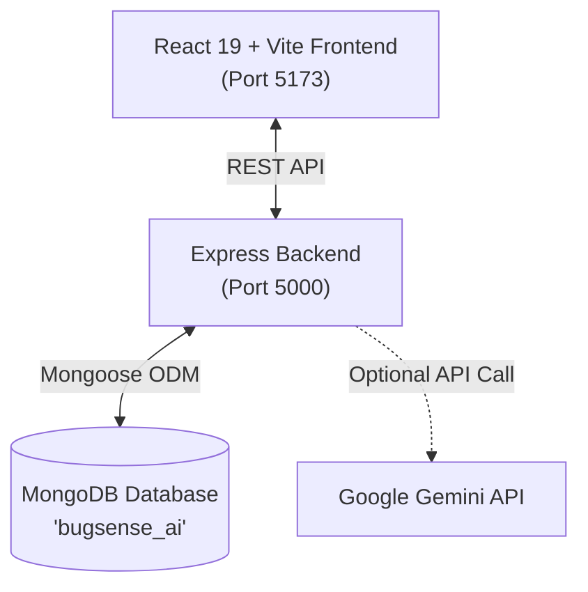

# ⚡ BugSense AI - Intelligent Error Explainer & Fix Assistant

> **BugSense AI** is a modern full-stack developer productivity tool designed to parse, explain, and resolve complex code errors and runtime exceptions using MongoDB knowledge storage and hybrid AI reasoning.

---

## 🌟 Key Features

- 🔍 **Instant Error Diagnostic**: Paste error logs, stack traces, and code snippets across JavaScript, Python, Java, C++, Go, and React.
- 🧠 **Hybrid AI & Heuristic Engine**: Powered by deep pattern heuristics out of the box, with optional Google Gemini Generative AI augmentation.
- ⚡ **MongoDB Similarity Search**: Checks newly submitted errors against indexed error cases in MongoDB to retrieve community-tested fixes and avoid redundant LLM queries.
- 📊 **Real-time Analytics Dashboard**: Tracks top error categories, language distribution, query volume, and resolution rates.
- 📚 **Interactive Knowledge Base**: Browse, search, and filter verified error solutions with difficulty ratings, explanations, and prevention tips.
- 🕒 **Query History**: Revisit previous debugging sessions and mark issues as resolved.
- 🎨 **Modern Dark UI**: Fluid animations, glow aesthetics, responsive layout, and interactive code diff views.

---

## 🏗️ Architecture & Tech Stack



### **Frontend**
- **Framework**: React 19 with Vite
- **Icons**: Lucide React
- **Styles**: Custom responsive CSS with dark glassmorphism design tokens

### **Backend**
- **Runtime**: Node.js (ES Modules)
- **Server**: Express 4.x
- **Database ODM**: Mongoose 8.x
- **AI Integration**: `@google/generative-ai` (optional, graceful fallback to built-in engine)

### **Database Schema (MongoDB)**
- `ErrorCase`: Verified error patterns, explanations, code diffs, tags, and helpfulness metrics.
- `QueryHistory`: Logged user queries, detected languages, suggested fixes, and resolution statuses.
- `Feedback`: User ratings and feedback on generated explanations.

---

## 🚀 Getting Started

### 1. Prerequisites
- **Node.js** (v18.0 or newer)
- **MongoDB** (running locally on port `27017` or via MongoDB Atlas URI)

### 2. Environment Setup
Create a `.env` file in the `server` directory (or copy from `.env.example`):

```bash
PORT=5000
MONGODB_URI=mongodb://127.0.0.1:27017/bugsense_ai

# Optional: Provide Google Gemini API Key for online generative AI analysis
# If left blank, BugSense AI uses its powerful built-in intelligent engine!
GEMINI_API_KEY=
```

### 3. Start Development Server
From the root workspace directory, run:

```bash
npm run dev
```

This starts both:
- **Backend API**: `http://localhost:5000`
- **Frontend App**: `http://localhost:5173`

*(Database will automatically seed with standard error patterns on first boot if empty).*

---

## 📋 Available Scripts

| Command | Action |
|---|---|
| `npm run dev` | Runs both backend and frontend concurrently via `dev-runner.js` |
| `npm run server` | Starts the Express server with file watching (`--watch`) |
| `npm run client` | Starts Vite client dev server |
| `npm run seed` | Manually re-seeds MongoDB with initial error cases |
| `npm run build` | Builds production client bundle |
| `npm --prefix client run build` | Directly builds client bundle into `client/dist` |

---

## 🌐 Production Deployment (Render + Vercel)

This project has a separated architecture:
- **Backend (Express + MongoDB)** is deployed to **Render** (Web Service).
- **Frontend (React + Vite)** is deployed to **Vercel** (Static Site / SPA).

### Step 1: Deploy Backend to Render

1. Push your project code to **GitHub**.
2. Go to [render.com](https://render.com) and create a **New Web Service**.
3. Connect your GitHub repository.
4. Set the following settings:
   - **Root Directory**: `server`
   - **Environment**: `Node`
   - **Build Command**: `npm install`
   - **Start Command**: `npm start`
5. Under **Environment Variables**, add:
   - `NODE_ENV`: `production`
   - `MONGODB_URI`: `<Your MongoDB Atlas Connection String>` *(e.g. `mongodb+srv://<user>:<password>@cluster.mongodb.net/bugsense_ai?retryWrites=true&w=majority`)*
   - `GEMINI_API_KEY`: *(Optional, your Google Gemini API Key)*
6. Click **Deploy**. Once finished, copy your Render service URL (e.g. `https://bugsense-server.onrender.com`).

> *Note: For Render, you need a cloud MongoDB database (like a free cluster on [MongoDB Atlas](https://www.mongodb.com/atlas)). Ensure network access in MongoDB Atlas allows IP `0.0.0.0/0` (Allow from anywhere).*

---

### Step 2: Deploy Frontend to Vercel

1. Go to [vercel.com](https://vercel.com) and click **Add New > Project**.
2. Import your GitHub repository.
3. Configure project settings:
   - **Framework Preset**: `Vite`
   - **Root Directory**: `client` *(or leave as `./` with our included root `vercel.json`)*
   - **Build Command**: `npm run build`
   - **Output Directory**: `dist`
4. Expand **Environment Variables** and add:
   - `VITE_API_URL`: `<Your Render Backend URL>` *(e.g. `https://bugsense-server.onrender.com`)*
5. Click **Deploy**!
6. Once deployed, test your live Vercel app. It will seamlessly send API requests to your Render backend.

---

---

## 🎯 Core Project Requirements: Validation, CRUD & Aggregation

BugSense AI is built strictly according to enterprise MongoDB standards, featuring robust **Schema & Input Validation**, **Complete CRUD Operations across multiple collections**, and **5 Multi-Stage MongoDB Aggregation Pipelines**.

---

### 1. 🛡️ Data & Schema Validation System

Validation is enforced across three distinct layers:

1. **Mongoose Model Schema Validation** (`server/models/`):
   - **`ErrorCase`**:
     - `errorMessage`: Required, trimmed, `minlength: [3]`, `maxlength: [500]`.
     - `rawError`: Required, trimmed, `minlength: [3]`.
     - `language`: Required enum whitelist of 15 programming languages (`javascript`, `python`, `java`, `cpp`, `go`, etc.).
     - `errorType`: Required, `minlength: [2]`, `maxlength: [100]`.
     - `severity`: Strict enum (`Critical`, `High`, `Medium`, `Low`).
     - `explanation`: Required, `minlength: [10]`.
     - `suggestedFix`: Embedded schema validating `fixedCode` is non-empty string and `explanation` is provided.
     - `tags`: Custom validator checking that each tag is a non-empty string under 40 characters.
     - `helpfulVotes`, `timesQueried`, `timesSolved`: Numeric constraints with `min: 0`.
   - **`Feedback`**:
     - `errorCaseId`: Required valid MongoDB `ObjectId` referencing `ErrorCase`.
     - `resolvedIssue`: Required boolean (`true` / `false`).
     - `rating`: Integer bounds constrained to `[1, 5]`.
     - `studentLevel`: Strict enum (`Beginner`, `Intermediate`, `Advanced`).
     - `studentComment`: Constrained to `maxlength: 1000`.
   - **`QueryHistory`**:
     - `queryText`: Required, `minlength: [2]`, `maxlength: [5000]`.
     - `actionTaken`: Enum (`used_similar_cache`, `requested_ai_explanation`, `browsed_knowledge_base`).
     - `similarityScore`: Constrained to `[0, 100]`.

2. **Express Input Validation Middleware** (`server/middleware/validate.js`):
   - `validateErrorCasePayload()`: Pre-validates incoming POST/PUT JSON bodies before hitting Mongoose.
   - `validateFeedbackPayload()`: Validates rating ranges and required feedback flags.
   - `validateObjectId()`: Verifies that URL parameters are valid 24-character hexadecimal MongoDB ObjectIds.

3. **Centralized Error Handling** (`server/middleware/errorHandler.js`):
   - Catches Mongoose `ValidationError` and transforms it into structured HTTP 400 Bad Request responses with field-by-field error maps.
   - Intercepts `CastError` (e.g. malformed ObjectId) to return HTTP 400 with the exact path.
   - Intercepts `E11000` MongoDB duplicate key errors and returns HTTP 409 Conflict.

4. **Client-Side Form Validation** (`client/src/App.jsx`):
   - Inline visual validation alerts before submission.
   - Graceful display of server validation error maps.

---

### 2. 🔄 Full CRUD Operations Matrix

BugSense AI provides complete, demonstrable CRUD capabilities across all collections:

| Operation | Method | Endpoint | Collection | Description |
|---|---|---|---|---|
| **CREATE (C)** | `POST` | `/api/errors` | `ErrorCase` | Manual error solution creation with schema validation |
| **CREATE (C)** | `POST` | `/api/errors/analyze` | `ErrorCase` + `QueryHistory` | Diagnostic & AI auto-indexing into MongoDB |
| **CREATE (C)** | `POST` | `/api/errors/:id/feedback` | `Feedback` | Submit student rating & comment linked via ObjectId |
| **CREATE (C)** | `POST` | `/api/history` | `QueryHistory` | Manual debug session logging |
| **READ (R)** | `GET` | `/api/errors` | `ErrorCase` | List with pagination, language filtering, regex search, and sorting |
| **READ (R)** | `GET` | `/api/errors/:id` | `ErrorCase` | Fetch solution by ID + auto-increment query counter |
| **READ (R)** | `GET` | `/api/errors/:id/feedback` | `Feedback` | Retrieve all feedback documents for a specific error case |
| **READ (R)** | `GET` | `/api/history` | `QueryHistory` | Fetch recent debugging history with populated error cases |
| **READ (R)** | `GET` | `/api/history/:id` | `QueryHistory` | Fetch single query log entry by ID |
| **READ (R)** | `GET` | `/api/analytics` | Multiple | High-level aggregated statistics |
| **READ (R)** | `GET` | `/api/analytics/pipelines` | Multiple | Catalog of all MongoDB aggregation pipelines |
| **UPDATE (U)** | `PUT` | `/api/errors/:id` | `ErrorCase` | Full update of title, explanation, code fix, tips, tags |
| **UPDATE (U)** | `PATCH` | `/api/errors/:id` | `ErrorCase` | Partial update of specific fields |
| **UPDATE (U)** | `PATCH` | `/api/history/:id` | `QueryHistory` | Toggle resolved status (`true` / `false`) |
| **DELETE (D)** | `DELETE` | `/api/errors/:id` | `ErrorCase` + `Feedback` | Cascading delete of solution and related feedback |
| **DELETE (D)** | `DELETE` | `/api/history/:id` | `QueryHistory` | Delete individual history record |
| **DELETE (D)** | `DELETE` | `/api/history` | `QueryHistory` | Clear all debugging query history |

---

### 3. ⚡ Advanced MongoDB Aggregation Pipelines

BugSense AI implements **5 dedicated, multi-stage MongoDB Aggregation Pipelines** (`server/services/aggregationPipelines.js`), accessible via API (`/api/analytics/pipelines/run/:id`) and interactively in the UI's **Analytics Aggregation Inspector**:

1. **Language Performance & Resolution Rate**:
   - **Stages**: `$group` &rarr; `$project` &rarr; `$sort`
   - **Operators Used**: `$sum`, `$avg`, `$addToSet`, `$divide`, `$multiply`, `$round`
   - **Goal**: Groups cases by language, calculates accumulated queries and solved cases, and computes real-time percentage resolution rates:
     $$\text{Resolution Rate} = \text{round}\left(\frac{\text{totalSolved}}{\text{totalQueries}} \times 100, 1\right)$$

2. **Tag Cloud Frequency Aggregation (`$unwind`)**:
   - **Stages**: `$unwind` &rarr; `$match` &rarr; `$group` &rarr; `$sort` &rarr; `$limit` &rarr; `$project`
   - **Operators Used**: `$unwind: '$tags'`, `$addToSet: '$language'`, `$avg: '$helpfulVotes'`
   - **Goal**: Flattens embedded tag arrays to identify the top 25 most frequent developer error tags and their associated languages.

3. **Cross-Collection Relational Join (`$lookup`)**:
   - **Stages**: `$lookup` &rarr; `$project` &rarr; `$sort` &rarr; `$limit`
   - **Operators Used**: `$lookup` (from `feedbacks`), `$size`, `$avg`, `$filter`, `$cond`
   - **Goal**: Joins `ErrorCase` with `Feedback` without application-side joins, computing live average star ratings and verified resolution ratios per solution.

4. **Multi-Faceted Dashboard Aggregation (`$facet`)**:
   - **Stages**: `$facet` &rarr; Sub-pipelines (`severityDistribution`, `categoryDistribution`, `summaryMetrics`, `topSolvedLeaderboard`)
   - **Goal**: Executes 4 independent aggregation pipelines in parallel within a single database roundtrip on the same document stream.

5. **Daily Query Trends & Time-Series**:
   - **Stages**: `$group` &rarr; `$project` &rarr; `$sort` &rarr; `$limit`
   - **Operators Used**: `$dateToString` (format: `%Y-%m-%d`), `$cond`
   - **Goal**: Formats ISO timestamps to daily buckets, aggregating query volume, resolution ratios, and cache-hit percentages.

---

### 🧪 One-Click Requirements Verification Script

To verify all three requirements live against MongoDB, run:

```bash
node server/scripts/verify-requirements.js
```

This automated test checks:
- ✅ **Validation**: Rejection of malformed schema inputs (field checks, length, enums).
- ✅ **CRUD**: Full Create &rarr; Read &rarr; Update &rarr; Delete cycle.
- ✅ **Aggregation**: Execution of all 5 multi-stage aggregation pipelines with timing in milliseconds.

---

## 🛡️ License

MIT License. Designed and built with ❤️ for developers.

