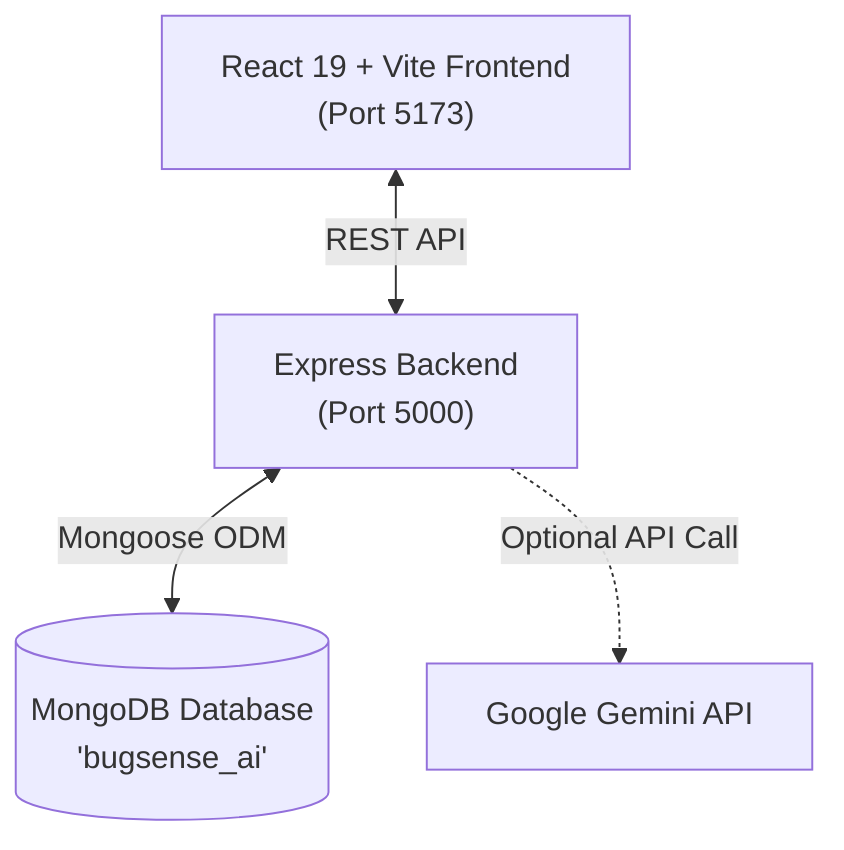

# ⚡ BugSense AI - Intelligent Error Explainer & Fix Assistant

> **BugSense AI** is a modern full-stack developer productivity tool designed to parse, explain, and resolve complex code errors and runtime exceptions using MongoDB knowledge storage and hybrid AI reasoning.

---

## 🌟 Key Features

- 🔍 **Instant Error Diagnostic**: Paste error logs, stack traces, and code snippets across JavaScript, Python, Java, C++, Go, and React.
- 🧠 **Hybrid AI & Heuristic Engine**: Powered by deep pattern heuristics out of the box, with optional Google Gemini Generative AI augmentation.
- ⚡ **MongoDB Similarity Search**: Checks newly submitted errors against indexed error cases in MongoDB to retrieve community-tested fixes and avoid redundant LLM queries.
- 📊 **Real-time Analytics Dashboard**: Tracks top error categories, language distribution, query volume, and resolution rates.
- 📚 **Interactive Knowledge Base**: Browse, search, and filter verified error solutions with difficulty ratings, explanations, and prevention tips.
- 🕒 **Query History**: Revisit previous debugging sessions and mark issues as resolved.
- 🎨 **Modern Dark UI**: Fluid animations, glow aesthetics, responsive layout, and interactive code diff views.

---

## 🏗️ Architecture & Tech Stack



### **Frontend**
- **Framework**: React 19 with Vite
- **Icons**: Lucide React
- **Styles**: Custom responsive CSS with dark glassmorphism design tokens

### **Backend**
- **Runtime**: Node.js (ES Modules)
- **Server**: Express 4.x
- **Database ODM**: Mongoose 8.x
- **AI Integration**: `@google/generative-ai` (optional, graceful fallback to built-in engine)

### **Database Schema (MongoDB)**
- `ErrorCase`: Verified error patterns, explanations, code diffs, tags, and helpfulness metrics.
- `QueryHistory`: Logged user queries, detected languages, suggested fixes, and resolution statuses.
- `Feedback`: User ratings and feedback on generated explanations.

---

## 🚀 Getting Started

### 1. Prerequisites
- **Node.js** (v18.0 or newer)
- **MongoDB** (running locally on port `27017` or via MongoDB Atlas URI)

### 2. Environment Setup
Create a `.env` file in the `server` directory (or copy from `.env.example`):

```bash
PORT=5000
MONGODB_URI=mongodb://127.0.0.1:27017/bugsense_ai

# Optional: Provide Google Gemini API Key for online generative AI analysis
# If left blank, BugSense AI uses its powerful built-in intelligent engine!
GEMINI_API_KEY=
```

### 3. Start Development Server
From the root workspace directory, run:

```bash
npm run dev
```

This starts both:
- **Backend API**: `http://localhost:5000`
- **Frontend App**: `http://localhost:5173`

*(Database will automatically seed with standard error patterns on first boot if empty).*

---

## 📋 Available Scripts

| Command | Action |
|---|---|
| `npm run dev` | Runs both backend and frontend concurrently via `dev-runner.js` |
| `npm run server` | Starts the Express server with file watching (`--watch`) |
| `npm run client` | Starts Vite client dev server |
| `npm run seed` | Manually re-seeds MongoDB with initial error cases |
| `npm run build` | Builds production client bundle |
| `npm --prefix client run build` | Directly builds client bundle into `client/dist` |

---

## 🌐 Production Deployment (Render + Vercel)

This project has a separated architecture:
- **Backend (Express + MongoDB)** is deployed to **Render** (Web Service).
- **Frontend (React + Vite)** is deployed to **Vercel** (Static Site / SPA).

### Step 1: Deploy Backend to Render

1. Push your project code to **GitHub**.
2. Go to [render.com](https://render.com) and create a **New Web Service**.
3. Connect your GitHub repository.
4. Set the following settings:
   - **Root Directory**: `server`
   - **Environment**: `Node`
   - **Build Command**: `npm install`
   - **Start Command**: `npm start`
5. Under **Environment Variables**, add:
   - `NODE_ENV`: `production`
   - `MONGODB_URI`: `<Your MongoDB Atlas Connection String>` *(e.g. `mongodb+srv://<user>:<password>@cluster.mongodb.net/bugsense_ai?retryWrites=true&w=majority`)*
   - `GEMINI_API_KEY`: *(Optional, your Google Gemini API Key)*
6. Click **Deploy**. Once finished, copy your Render service URL (e.g. `https://bugsense-server.onrender.com`).

> *Note: For Render, you need a cloud MongoDB database (like a free cluster on [MongoDB Atlas](https://www.mongodb.com/atlas)). Ensure network access in MongoDB Atlas allows IP `0.0.0.0/0` (Allow from anywhere).*

---

### Step 2: Deploy Frontend to Vercel

1. Go to [vercel.com](https://vercel.com) and click **Add New > Project**.
2. Import your GitHub repository.
3. Configure project settings:
   - **Framework Preset**: `Vite`
   - **Root Directory**: `client` *(or leave as `./` with our included root `vercel.json`)*
   - **Build Command**: `npm run build`
   - **Output Directory**: `dist`
4. Expand **Environment Variables** and add:
   - `VITE_API_URL`: `<Your Render Backend URL>` *(e.g. `https://bugsense-server.onrender.com`)*
5. Click **Deploy**!
6. Once deployed, test your live Vercel app. It will seamlessly send API requests to your Render backend.

---

## 🛠️ Complete CRUD API Reference

BugSense AI provides full, standard CRUD endpoints for knowledge base error cases and debugging query logs:

### 1. Error Cases (`/api/errors`)
| Operation | Method | Endpoint | Description |
|---|---|---|---|
| **Create (C)** | `POST` | `/api/errors` | Manually create and index a new error case / fix |
| **Create (AI)** | `POST` | `/api/errors/analyze` | AI diagnostics + automatic case creation in MongoDB |
| **Read (R)** | `GET` | `/api/errors` | Query, filter by language/tags, search, and paginate error cases |
| **Read (R)** | `GET` | `/api/errors/:id` | Fetch specific error solution details by ID |
| **Update (U)** | `PUT` | `/api/errors/:id` | Update title, explanation, code snippet, fix, or tags |
| **Update (Votes)** | `POST` | `/api/errors/:id/feedback` | Record student feedback & increment helpfulness votes |
| **Delete (D)** | `DELETE` | `/api/errors/:id` | Permanently remove an error solution and its feedback |

### 2. Query History (`/api/history`)
| Operation | Method | Endpoint | Description |
|---|---|---|---|
| **Create (C)** | Auto | `/api/errors/analyze` | Automatically logged upon error submission |
| **Read (R)** | `GET` | `/api/history` | Retrieve recent student debugging queries |
| **Update (U)** | `PATCH` | `/api/history/:id` | Toggle status (Resolved / Open) |
| **Delete (D)** | `DELETE` | `/api/history/:id` | Delete a single history record |
| **Delete (All)**| `DELETE` | `/api/history` | Clear all debugging history |

---

## 🛡️ License

MIT License. Designed and built with ❤️ for developers.
